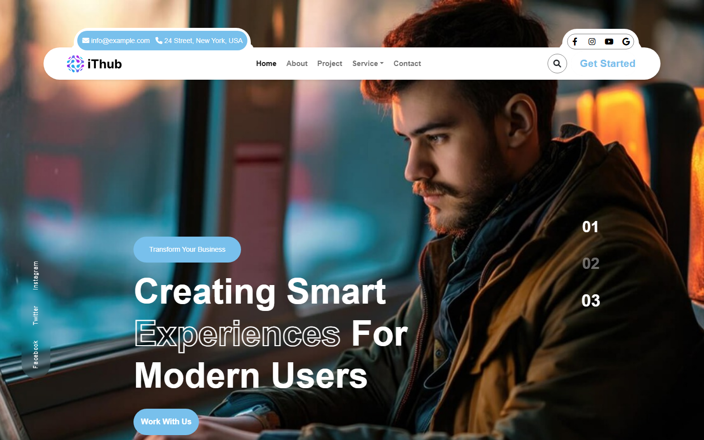

⚠️ This template was originally created by Mohammed Sabry
credit is required: github.com/Mohammedsabry13

# iTHub — IT Consulting & Tech Solutions Corporate Website

A feature-rich corporate website for **iTHub-iT Consulting**, a technology solutions and IT services company delivering digital transformation, startup tech solutions, and IT consulting with 97% success rate and 8M+ satisfied clients.

## 🛠️ Tech Stack

- **HTML5 & CSS3** — semantic structure and custom styling
- **Bootstrap 5** — responsive grid, mega-menu dropdown
- **Swiper.js 7** — carousel sliders
- **Owl Carousel** — team / testimonials slider
- **WOW.js + Animate.css** — scroll-triggered entrance animations
- **Font Awesome** — icon set
- **Roboto + Londrina Outline + Squada One** — Google Fonts layered typography
- **Vanilla JavaScript** — hero slider, WOW.js init, interactions

## ✨ Features

- **Dual header** — top info bar (email, address, social icons) + pill-shaped sticky navbar with mega-menu dropdown for Services
- **3-slide animated hero** — fullscreen background slides with numbered dot nav (01/02/03), WOW.js badge (flipInX), title (fadeInDownBig), CTA button (rotateIn), social links sidebar (bounceInRight)
- **About / Exclusive Tech section** — decorative floating patterns, overlapping dual-image composition, years graphic, animated dots label group
- **Reverse CSS marquee ticker** — "MARKETING ENGINE." infinite scrolling text in outlined style
- **Achievements section** — 5 stats grid (8M Clients, 316 Reviews, 97% Success Rate, 42 Team Members, 4,500 Years of Experience) with decorative floating vector shapes and video play button with animated rings
- **4-step Work Process section** — numbered steps with icons and descriptions
- **Services section** — service cards grid with icons
- **Team section** — Owl Carousel team member cards with social links
- **Blog / News section** — article cards with image, date, category and excerpt
- **Contact form** — name, email, subject and message fields
- **Footer** — logo, quick links, social icons and newsletter signup
- WOW.js animations throughout: bounce, fadeIn, slideInLeft, rotateInUpLeft, bounceInDown, bounceInUp, flipInX, fadeInDownBig
- Fully responsive across all screen sizes
